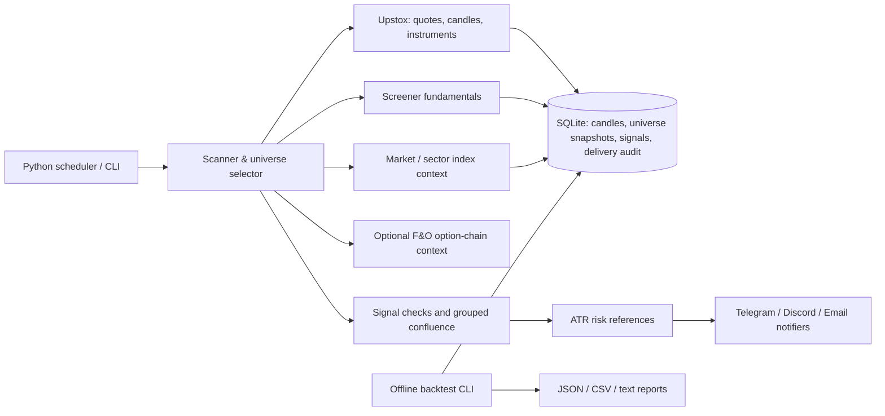

# Stock Monitor

An NSE-focused swing-trading **signal research and alerting framework**. It reads Upstox market data, evaluates completed daily candles (and a separately labelled provisional intraday path during an open session), applies configured universe/confluence rules, persists results in SQLite, and optionally sends alerts. It does not place orders.

## What it does

- Selects a verified NSE equity universe (`nifty500` is the checked-in default; other supported modes are `all_nse`, `custom`, and `composed`).
- Maintains daily OHLCV and selected-universe snapshots/checkpoints in SQLite.
- Scans at the configured interval during NSE market hours using validated, batched Upstox quotes and cached completed daily candles.
- Evaluates RSI, MACD, EMA crossover/trend-state, and volume breakout checks. Related checks vote as independent groups: trend, momentum, and participation.
- Optionally adds completed-session liquidity screening, market/sector regime context, fundamental freshness, open-interest context, and ATR-based risk references.
- Sends configured notifications through Telegram, Discord, and email. WhatsApp settings are present but not currently wired into the notifier factory.
- Provides cache maintenance, one-shot scans/refreshes, and offline historical backtests.

## Architecture



- `src/main.py` starts the in-process scheduler, initializes SQLite and the verified instrument master, schedules market scans and daily cache/universe refreshes, and handles shutdown.
- `src/scanner.py` coordinates data validation, universe eligibility, indicators, grouped voting, context, alert persistence, and delivery deduplication.
- `src/universe.py`, `src/market_calendar.py`, and `src/market_context.py` implement constituent selection, NSE session rules, and benchmark/sector/liquidity calculations.
- `src/fetcher/` contains the Upstox client/OAuth flow and Screener fundamentals cache.
- `src/signals/` contains RSI, MACD, EMA, volume and confluence logic. `src/risk.py` computes informational ATR references.
- `src/notifiers/` contains delivery adapters. `src/backtest/` replays the configured strategy against local daily candles without network calls or notifications.
- `config/config.yaml` is the safe-to-commit settings file; ignored `config/secrets.yaml`, `.env`, and supported environment variables override secret values.
- `data/stocks.db` is local SQLite state. It, tokens, logs, charts, reports, and secrets are intentionally excluded from Git.

## Getting started

- [SETUP.md](SETUP.md): clone and install on Linux or Windows, configure credentials, perform OAuth, warm the cache, and run the service.
- [USAGE.md](USAGE.md): commands, scheduling, alerts, all checked-in config settings and their effects, universe modes, and operational safety notes.
- [Upstox quote contract notes](docs/upstox_quote_contract.md).

Quick Linux development setup:

```bash
git clone https://github.com/vsp9714-sys/stock-monitor.git
cd stock-monitor
python3.11 -m venv .venv
source .venv/bin/activate
python -m pip install --upgrade pip
python -m pip install -r requirements.txt
cp config/secrets.yaml.example config/secrets.yaml
# Edit config/secrets.yaml, then complete OAuth:
python -m src.fetcher.upstox_auth_setup
```

## Defaults and important behavior

- The checked-in universe is Nifty 500 with an enabled 20-session average traded-value threshold of ₹1 crore and 20 observations. Actual selected/evaluable counts vary with verified constituents, data coverage, and provider availability.
- NSE timezone is `Asia/Kolkata`; regular session window is 09:15–15:30 IST, weekdays, using the versioned calendar in `config/nse_trading_calendar.yaml`. Unknown calendar years fail closed.
- Confluence defaults to at least two agreeing independent groups, fresh-event `crossover` mode, and rejection of conflicting directions. RSI defaults to mean-reversion and level confirmation.
- Confirmed alerts use completed daily candles. Provisional intraday alerts are separately labelled/deduplicated, use current-session OHLC only in memory, and do not write partial bars to the canonical daily cache. Provisional volume uses the accepted comparison with full prior-day volumes, not a time-of-day-adjusted baseline.
- Market/sector context is informational by default. Derivatives/OI context is disabled by default. ATR risk levels are estimates, never orders; position size is omitted unless account capital and risk percent are configured.
- The daily 06:00 IST readiness job refreshes cache only when the configured provider probes agree on the latest completed session. It does not scan or alert. The every-15-minute scheduler is separate.

## License and intended use

This repository is provided for software and research use. It is not investment advice, an execution system, or a guarantee of results. Review provider terms, data quality, configuration, and backtest assumptions before relying on alerts. No license file is currently included.
