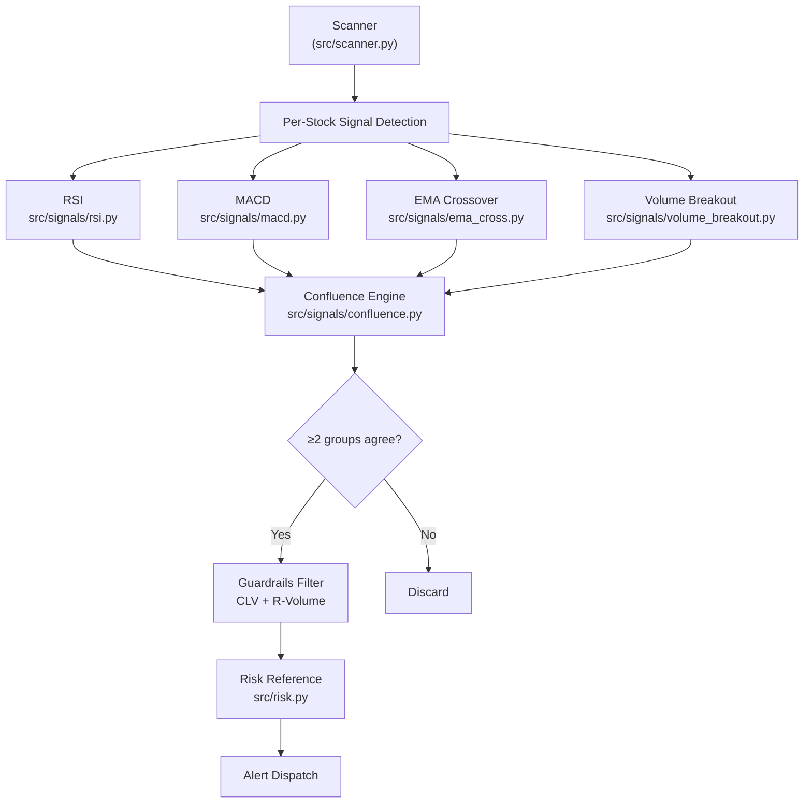
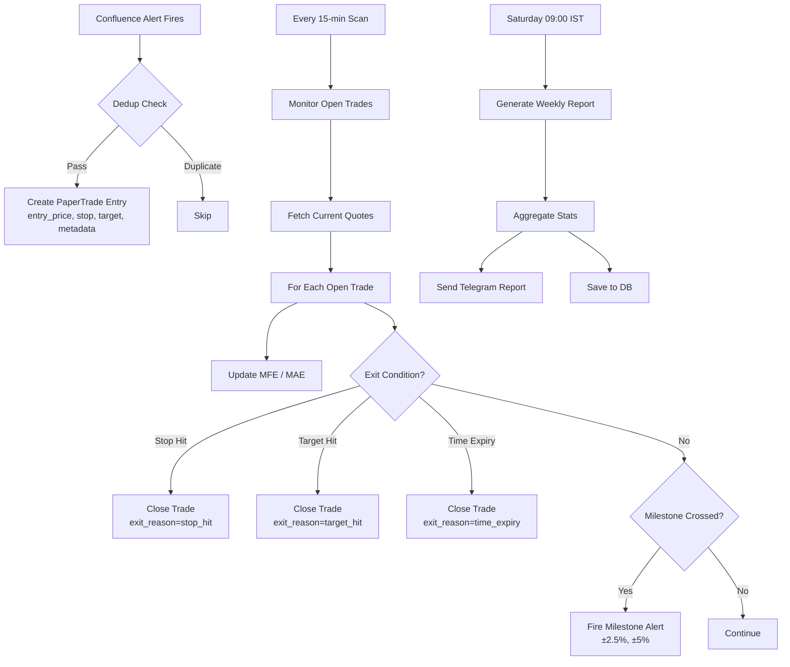

# Handoff Document: Signal Framework Review & Paper Trading System

> [!IMPORTANT]
> This is a **planning document** for a smaller model to implement. It covers two major workstreams:
> 1. **Signal Framework Analysis & Improvements** — strengthen swing candidate identification
> 2. **Paper Trading & Validation Framework** — empirically measure alert quality

---

## Table of Contents

1. [Current Framework Audit](#1-current-framework-audit)
2. [Gap Analysis & Recommendations](#2-gap-analysis--recommendations)
3. [Implementation Plan: Signal Improvements](#3-implementation-plan-signal-improvements)
4. [Paper Trading Framework Design](#4-paper-trading-framework-design)
5. [Integration Points & File Map](#5-integration-points--file-map)
6. [Config Changes](#6-config-changes)
7. [Testing Strategy](#7-testing-strategy)

---

## 1. Current Framework Audit

### Architecture Overview



### Signal Groups (One Vote Per Group)

| Group | Signal(s) | What It Detects | Swing Relevance |
|-------|-----------|-----------------|-----------------|
| **Trend** | EMA 9×21, 21×50, 50×200 crossovers | Trend direction shifts | ✅ Core — but all 3 are correlated (all EMA-based), and no trend **strength** is measured |
| **Momentum** | RSI-14 (mean reversion ≤30/≥70) + MACD 12/26/9 crossover | Momentum shifts | ⚠️ RSI uses extreme levels (30/70) that rarely trigger in trending markets; MACD crossover is lagging |
| **Participation** | Volume Breakout (2× avg + N-day high break) | Institutional activity | ✅ Good but binary — no delivery volume analysis |

### Existing Guardrails

| Guardrail | File | Purpose |
|-----------|------|---------|
| CLV Wick Filter | [scanner.py](file:///home/ubuntu/repos/stock-monitor/src/scanner.py) | Rejects false breakouts where close is in the wrong part of the range |
| R-Volume Pace | [volume_breakout.py](file:///home/ubuntu/repos/stock-monitor/src/signals/volume_breakout.py) | Normalizes intraday volume using NSE U-curve |
| Two-Tier Alerts | [scanner.py](file:///home/ubuntu/repos/stock-monitor/src/scanner.py) | Radar (intraday) vs Confirmed Entry (3:15 PM) |
| Direction Consensus | [confluence.py](file:///home/ubuntu/repos/stock-monitor/src/signals/confluence.py) | Discards stocks with conflicting BUY vs SELL across groups |
| Market Context | [market_context.py](file:///home/ubuntu/repos/stock-monitor/src/market_context.py) | Benchmark regime + sector regime (informational mode) |

### Observations

1. **All trend signals are EMA-derived** — highly correlated. A stock triggering 9×21 crossover is very likely to also show 21×50 alignment. Despite "one vote per group" dedup, the entire trend group captures only one dimension: moving average direction.

2. **RSI at 30/70 is too extreme for swing trading** — in a strong uptrend, RSI rarely drops below 30. The existing `trend_momentum` mode (55/45 thresholds) exists in code but is **not enabled** in config (`mode: "mean_reversion"`). This means the momentum group's RSI vote almost never fires during trending markets, which is exactly when swing candidates appear.

3. **MACD is a lagging indicator** — by the time MACD crosses, significant price movement has already occurred. For swing trading, MACD histogram slope or zero-line proximity are more useful than crossover events.

4. **No trend strength measurement** — the system knows *direction* but not *strength*. ADX (Average Directional Index) > 25 would filter out choppy/sideways markets where crossover signals generate whipsaws.

5. **No price structure awareness** — no support/resistance detection, no Bollinger Band squeeze, no pivot points. The system can't tell if a stock is breaking out of a range vs. running into overhead supply.

6. **Volume analysis is binary** — "volume > 2× average" with no delivery percentage. In NSE, delivery volume % is a critical institutional footprint (>50% delivery on breakout day = genuine accumulation vs. speculative trading volume).

7. **No relative strength ranking** — all Nifty 500 stocks are treated equally. No mechanism to identify which stocks/sectors are showing relative outperformance vs. Nifty 50.

---

## 2. Gap Analysis & Recommendations

### Priority Matrix

| Indicator | Effort | Impact | Priority | Add To |
|-----------|--------|--------|----------|--------|
| **ADX Trend Strength Filter** | Low | High | 🔴 P0 | Existing framework (guardrail) |
| **RSI Mode Switch to trend_momentum** | Trivial | High | 🔴 P0 | Config change only |
| **Supertrend Indicator** | Medium | High | 🟡 P1 | Parallel signal (new group or trend group) |
| **Bollinger Band Squeeze** | Medium | High | 🟡 P1 | New signal group "volatility" |
| **Relative Strength vs Nifty** | Low | Medium | 🟡 P1 | Existing framework (enrichment) |
| **Candlestick Pattern Recognition** | High | Medium | 🟢 P2 | Parallel confirmation layer |
| **OBV Divergence** | Medium | Medium | 🟢 P2 | Participation group enhancement |
| **Delivery Volume %** | Medium | High | 🟡 P1 | Participation group enhancement |
| **MACD Histogram Momentum** | Low | Medium | 🟢 P2 | Momentum group enhancement |

### Detailed Recommendations

#### 🔴 P0 — Implement Immediately

##### 2a. ADX Trend Strength Filter (New Guardrail)

**What**: Average Directional Index measures trend strength regardless of direction. ADX > 25 = trending, ADX < 20 = choppy/ranging.

**Why**: The #1 source of false signals in EMA/MACD systems is sideways markets. ADX filters these out before confluence evaluation.

**How**: Add as a guardrail in `scanner.py`, not a signal group. When ADX < 20, suppress all crossover-type alerts for that stock. When ADX > 25, add it as a "trend strength confirmed" note in the alert.

**Formula**:
```
+DI = 100 × EMA(+DM, period) / EMA(TR, period)
-DI = 100 × EMA(-DM, period) / EMA(TR, period)
DX  = 100 × |+DI − −DI| / (+DI + −DI)
ADX = EMA(DX, period)      # typically period = 14
```

**New file**: `src/signals/adx.py`

```python
# Signature
def compute_adx(df: pd.DataFrame, period: int = 14) -> pd.DataFrame:
    """Return DataFrame with columns: plus_di, minus_di, adx."""
    ...

def adx_filter(df: pd.DataFrame, period: int = 14, min_adx: float = 20.0) -> dict:
    """Return {'passed': bool, 'adx': float, 'plus_di': float, 'minus_di': float, 'trend_strength': str}"""
    ...
```

**Integration point**: In `Scanner._call_scan_stock()` after confluence passes but before alert dispatch (same location as CLV wick filter).

##### 2b. RSI Mode Switch

**What**: Change `config.yaml` → `signals.rsi.mode` from `"mean_reversion"` to `"trend_momentum"`.

**Why**: The existing `trend_momentum` mode uses 55/45 thresholds which fire when RSI crosses above 55 (bullish strength) or below 45 (bearish weakness). This is far more useful for swing trading than waiting for RSI < 30.

**Config change**:
```yaml
signals:
  rsi:
    mode: "trend_momentum"  # was: "mean_reversion"
    # Keep mean_reversion thresholds for reference
    oversold_threshold: 30
    overbought_threshold: 70
    # These are the active thresholds in trend_momentum mode
    bullish_threshold: 55
    bearish_threshold: 45
```

> [!NOTE]
> The code for `trend_momentum` mode already exists in [rsi.py](file:///home/ubuntu/repos/stock-monitor/src/signals/rsi.py). This is a config-only change. No new code needed.

#### 🟡 P1 — Implement Next

##### 2c. Supertrend Indicator (New Signal)

**What**: Supertrend is a trend-following overlay using ATR. Extremely popular in Indian market swing trading.

**Formula**:
```
Upper Band = (High + Low) / 2 + (Multiplier × ATR)
Lower Band = (High + Low) / 2 - (Multiplier × ATR)
Supertrend = Lower Band when price > Supertrend (bullish)
           = Upper Band when price < Supertrend (bearish)
```

**Parameters**: `period=10, multiplier=3.0` (standard for daily charts)

**Signal**: Direction flip from bearish → bullish = BUY event; bullish → bearish = SELL event.

**New file**: `src/signals/supertrend.py`

```python
@dataclass
class SupertrendResult:
    symbol: str
    signal_type: Optional[str]  # "supertrend_bullish_flip", "supertrend_bearish_flip"
    direction: Optional[str]
    supertrend_value: float
    price: float
    triggered: bool
    event_triggered: bool = False
    event_direction: Optional[str] = None
    trend_direction: Optional[str] = None  # current state: BUY or SELL

def detect_supertrend(symbol: str, df: pd.DataFrame, period: int = 10,
                      multiplier: float = 3.0) -> SupertrendResult:
    ...
```

**Group assignment**: Add to the **trend** group in `confluence.py`:
```python
def signal_group(signal_type: str) -> str:
    if signal_type.startswith("ema_") or signal_type.startswith("supertrend_"):
        return "trend"
    ...
```

##### 2d. Bollinger Band Squeeze → Expansion (New Signal Group)

**What**: Bollinger Bands measure volatility. When bands squeeze tight (bandwidth < 20-day avg bandwidth), a breakout is imminent. When price closes outside bands with expanding bandwidth, it confirms the move.

**Why**: This captures a completely different dimension — **volatility contraction/expansion** — that no current signal covers. It's one of the best leading indicators for swing entries.

**New file**: `src/signals/bollinger.py`

```python
@dataclass
class BollingerResult:
    symbol: str
    signal_type: Optional[str]  # "bb_squeeze_breakout_up", "bb_squeeze_breakout_down"
    direction: Optional[str]
    upper_band: float
    lower_band: float
    bandwidth: float
    bandwidth_percentile: float  # vs last 120 days
    price: float
    triggered: bool
    event_triggered: bool = False
    event_direction: Optional[str] = None

def detect_bollinger_squeeze(symbol: str, df: pd.DataFrame,
                              period: int = 20, num_std: float = 2.0,
                              squeeze_percentile: float = 20.0) -> BollingerResult:
    """
    Trigger when:
    1. Bandwidth was in bottom 20th percentile (squeeze) within last 5 bars
    2. Price closes above upper band (BUY) or below lower band (SELL)
    3. Current bandwidth is expanding (> previous bar's bandwidth)
    """
    ...
```

**Group assignment**: Create a **new 4th group** called `"volatility"`:
```python
SIGNAL_GROUPS = ("trend", "momentum", "participation", "volatility")

def signal_group(signal_type: str) -> str:
    ...
    if signal_type.startswith("bb_"):
        return "volatility"
    ...
```

> [!WARNING]
> Adding a 4th group changes the confluence dynamics. With `min_groups_to_alert: 2`, you'd still need 2-of-4 agreement. Consider increasing to `min_groups_to_alert: 2` (keep same) but adding a config option for `max_groups: 4` to track coverage. The system becomes more selective because there are more independent dimensions to agree.

##### 2e. Relative Strength vs Nifty (Enrichment)

**What**: Calculate each stock's relative performance vs Nifty 50 over 20 and 50 sessions. Rank within sector and overall.

**Why**: Stocks with high relative strength during market pullbacks are the best swing candidates. This is already partially implemented in [market_context.py](file:///home/ubuntu/repos/stock-monitor/src/market_context.py) via the `relative_strength()` function, but it's only used as informational text in alerts — not as a filter or ranking.

**Enhancement**: Add an RS rating (1-99 scale, like IBD) to the alert and optionally use it as a guardrail (e.g., only alert on stocks with RS > 50).

**Integration point**: The `relative_strength()` function already exists. Add a new function:
```python
def rs_rating(stock_returns_pct: float, benchmark_returns_pct: float,
              universe_returns: list[float]) -> int:
    """Return 1-99 percentile rank of stock's relative performance vs universe."""
    ...
```

##### 2f. Delivery Volume % (NSE-Specific Enhancement)

**What**: NSE publishes delivery volume (shares actually transferred to demat accounts) separately from traded volume. High delivery % on a breakout day = institutional conviction.

**Why**: A stock can show 3× average volume but if 80% is intraday (speculative) trading, the breakout is likely to fade. If delivery % > 50% on a breakout day, institutions are accumulating.

**Challenge**: Delivery data requires NSE bhavcopy download (available after market close ~18:00 IST). This can be fetched from `nsearchives.nseindia.com` or NSE's new API.

**New file**: `src/fetcher/nse_delivery.py`

```python
def fetch_delivery_data(trade_date: date) -> dict[str, float]:
    """Fetch delivery % for all stocks from NSE bhavcopy.
    Returns: {symbol: delivery_pct, ...}
    Source: https://nsearchives.nseindia.com/products/content/sec_bhavdata_full_{date}.csv
    """
    ...
```

**Integration**: Add delivery_pct to volume_breakout check. When delivery data is available (post-close), add it as a confirmation flag. During intraday (delivery data unavailable), skip this check.

#### 🟢 P2 — Implement Later

##### 2g. Candlestick Pattern Recognition

**What**: Detect engulfing (bullish/bearish), hammer, doji, morning/evening star patterns.

**Why**: Candlestick patterns at key support/resistance levels are powerful confirmation signals. However, they're complex to implement reliably and have higher false-positive rates when used in isolation.

**Recommendation**: Implement as a **confirmation layer** that adds a "pattern_confirmed" flag to alerts, not as an independent signal group. Use `ta-lib` if available, or implement the top 5 most reliable patterns manually.

**New file**: `src/signals/candlestick.py`

```python
def detect_candlestick_patterns(df: pd.DataFrame) -> list[dict]:
    """Return list of detected patterns on the last 3 bars.
    Each dict: {'pattern': str, 'direction': str, 'strength': float}
    Patterns: bullish_engulfing, bearish_engulfing, hammer, inverted_hammer,
              morning_star, evening_star, doji_star
    """
    ...
```

##### 2h. OBV (On-Balance Volume) Divergence

**What**: OBV adds volume on up-closes and subtracts on down-closes. When price makes a new high but OBV doesn't → bearish divergence (distribution). When price makes a new low but OBV doesn't → bullish divergence (accumulation).

**New file**: `src/signals/obv.py`

```python
def detect_obv_divergence(df: pd.DataFrame, lookback: int = 20) -> dict:
    """Detect OBV vs price divergence.
    Returns: {'divergence': 'bullish'|'bearish'|None, 'obv_slope': float, 'price_slope': float}
    """
    ...
```

##### 2i. MACD Histogram Momentum

**What**: Instead of only detecting MACD line × signal line crossovers, also detect histogram momentum — when histogram bars are increasing in height (accelerating momentum) even before a crossover.

**Enhancement to existing** [macd.py](file:///home/ubuntu/repos/stock-monitor/src/signals/macd.py):
```python
# Add to MACDResult:
histogram_slope: Optional[str] = None  # "accelerating", "decelerating", None
histogram_bars_rising: int = 0  # consecutive bars of increasing histogram
```

---

## 3. Implementation Plan: Signal Improvements

### Phase 1: Config + ADX (Effort: ~2 hours)

```
Step 1: Change config.yaml RSI mode to trend_momentum
Step 2: Create src/signals/adx.py with compute_adx() and adx_filter()
Step 3: Add adx guardrail config section to config.yaml
Step 4: Integrate adx_filter() in scanner.py after confluence, before alert
Step 5: Add ADX value to alert message template
Step 6: Write tests in tests/signals/test_adx.py
```

### Phase 2: Supertrend + Bollinger (Effort: ~4 hours)

```
Step 1: Create src/signals/supertrend.py
Step 2: Create src/signals/bollinger.py
Step 3: Update confluence.py SIGNAL_GROUPS and signal_group() mapper
Step 4: Add supertrend and bollinger config sections
Step 5: Wire into scanner.py's _call_scan_stock() signal detection loop
Step 6: Write tests for both new signals
Step 7: Update alert message template to show new signals
```

### Phase 3: RS Rating + Delivery Volume (Effort: ~3 hours)

```
Step 1: Add rs_rating() to market_context.py
Step 2: Create src/fetcher/nse_delivery.py
Step 3: Add delivery_pct to volume_breakout enrichment
Step 4: Add RS rating to alert enrichment
Step 5: Optional: Add RS and delivery guardrail thresholds to config
Step 6: Write tests
```

### Phase 4: Candlestick + OBV + MACD Enhancement (Effort: ~4 hours)

```
Step 1: Create src/signals/candlestick.py (top 5 patterns)
Step 2: Create src/signals/obv.py
Step 3: Enhance macd.py with histogram momentum
Step 4: Wire candlestick as confirmation flag in alerts
Step 5: Wire OBV as participation group enhancement
Step 6: Write tests
```

---

## 4. Paper Trading Framework Design

### 4.1 Purpose

Empirically validate whether the existing (and improved) signal framework generates **profitable** swing trade entries. Track every alert as a paper trade, monitor P&L, and produce weekly scorecards.

### 4.2 Database Schema

Add three new tables to [src/db.py](file:///home/ubuntu/repos/stock-monitor/src/db.py):

```python
class PaperTrade(Base):
    """Auto-created paper trade entry when a confluence alert fires."""
    __tablename__ = "paper_trades"

    id = Column(Integer, primary_key=True)
    signal_id = Column(Integer, ForeignKey("signals.id"), nullable=False, index=True)
    symbol = Column(String(30), nullable=False, index=True)
    direction = Column(String(4), nullable=False)  # BUY or SELL
    entry_price = Column(Float, nullable=False)
    entry_date = Column(Date, nullable=False)
    entry_datetime = Column(DateTime, nullable=False)

    # ATR-based levels (from risk_reference at entry time)
    stop_loss = Column(Float, nullable=False)
    target_price = Column(Float, nullable=False)
    atr_at_entry = Column(Float)
    risk_distance = Column(Float)  # entry - stop (for BUY)

    # Signal metadata for analysis
    confluence_score = Column(Integer)       # 2 or 3
    alert_tier = Column(String(20))          # "radar" or "confirmed_entry"
    signal_groups_json = Column(Text)        # JSON: {"trend": "BUY", "momentum": "BUY"}

    # Exit tracking
    exit_price = Column(Float)
    exit_date = Column(Date)
    exit_datetime = Column(DateTime)
    exit_reason = Column(String(30))         # "stop_hit", "target_hit", "time_expiry", "manual"
    pnl_absolute = Column(Float)             # exit_price - entry_price (for BUY)
    pnl_percent = Column(Float)              # (exit - entry) / entry * 100
    r_multiple = Column(Float)               # pnl_absolute / risk_distance
    max_favorable_excursion = Column(Float)   # Best price seen during trade
    max_adverse_excursion = Column(Float)     # Worst price seen during trade

    # State
    status = Column(String(10), nullable=False, default="open")  # open, closed
    created_at = Column(DateTime, nullable=False)
    updated_at = Column(DateTime)

    __table_args__ = (
        UniqueConstraint("symbol", "direction", "entry_date", name="uq_paper_trade_symbol_dir_date"),
    )


class PaperTradeMilestone(Base):
    """P&L milestone alerts — tracks when ±2.5%, ±5% etc. are hit."""
    __tablename__ = "paper_trade_milestones"

    id = Column(Integer, primary_key=True)
    trade_id = Column(Integer, ForeignKey("paper_trades.id"), nullable=False, index=True)
    milestone_pct = Column(Float, nullable=False)    # +2.5, -2.5, +5.0, -5.0
    hit_price = Column(Float, nullable=False)
    hit_datetime = Column(DateTime, nullable=False)
    notified = Column(Boolean, default=False)
    notified_at = Column(DateTime)

    __table_args__ = (
        UniqueConstraint("trade_id", "milestone_pct", name="uq_milestone_trade_pct"),
    )


class PaperTradeWeeklyReport(Base):
    """Aggregated weekly performance snapshot."""
    __tablename__ = "paper_trade_weekly_reports"

    id = Column(Integer, primary_key=True)
    week_start = Column(Date, nullable=False)       # Monday of the week
    week_end = Column(Date, nullable=False)          # Friday of the week
    total_trades = Column(Integer, default=0)
    open_trades = Column(Integer, default=0)
    closed_trades = Column(Integer, default=0)
    winners = Column(Integer, default=0)
    losers = Column(Integer, default=0)
    win_rate_pct = Column(Float)
    avg_pnl_pct = Column(Float)
    avg_r_multiple = Column(Float)
    best_trade_symbol = Column(String(30))
    best_trade_pnl_pct = Column(Float)
    worst_trade_symbol = Column(String(30))
    worst_trade_pnl_pct = Column(Float)
    # Breakdown by signal tier
    radar_trades = Column(Integer, default=0)
    radar_win_rate = Column(Float)
    confirmed_trades = Column(Integer, default=0)
    confirmed_win_rate = Column(Float)
    # Breakdown by confluence score
    score_2_trades = Column(Integer, default=0)
    score_2_win_rate = Column(Float)
    score_3_trades = Column(Integer, default=0)
    score_3_win_rate = Column(Float)
    report_json = Column(Text)                       # Full detailed JSON
    generated_at = Column(DateTime, nullable=False)

    __table_args__ = (
        UniqueConstraint("week_start", name="uq_weekly_report_week"),
    )
```

### 4.3 Deduplication Strategy

**Unique constraint**: `(symbol, direction, entry_date)` — one paper trade per stock per direction per trading day.

**Cooldown rule**: Before creating a new paper trade, check if there's an **open** paper trade for the same symbol in the same direction. If yes, skip (don't create a duplicate). This prevents re-entering a stock that already has an active paper trade.

```python
def should_create_paper_trade(session: Session, symbol: str, direction: str, 
                               entry_date: date) -> bool:
    """Check deduplication rules before creating a paper trade."""
    # Rule 1: No duplicate for same symbol+direction+date
    existing = session.query(PaperTrade).filter_by(
        symbol=symbol, direction=direction, entry_date=entry_date
    ).first()
    if existing:
        return False
    
    # Rule 2: No new trade if same symbol+direction is already open
    open_trade = session.query(PaperTrade).filter_by(
        symbol=symbol, direction=direction, status="open"
    ).first()
    if open_trade:
        return False
    
    return True
```

### 4.4 Entry Logic

**When**: Every time a confluence alert is dispatched (after guardrails pass), auto-create a paper trade.

**Where**: In `Scanner._call_scan_stock()`, right after `upsert_signal()` and before/alongside alert dispatch.

**Entry price**: Use the `last_price` from the quote that triggered the alert (already available in scanner context).

**Stop & Target**: Use `risk_reference()` output — already computed in scanner for the alert message.

```python
# In scanner.py, after confluence passes and signal is saved:
def _create_paper_trade_entry(self, session, signal_id, symbol, direction, 
                                entry_price, risk_ref, confluence_result, alert_tier):
    """Create paper trade entry from alert context."""
    if not should_create_paper_trade(session, symbol, direction, date.today()):
        return None
    
    trade = PaperTrade(
        signal_id=signal_id,
        symbol=symbol,
        direction=direction,
        entry_price=entry_price,
        entry_date=date.today(),
        entry_datetime=datetime.now(IST),
        stop_loss=risk_ref.get("stop_reference", 0),
        target_price=risk_ref.get("target_reference", 0),
        atr_at_entry=risk_ref.get("atr"),
        risk_distance=risk_ref.get("risk_distance"),
        confluence_score=confluence_result["score"],
        alert_tier=alert_tier,
        signal_groups_json=json.dumps(confluence_result.get("group_votes", {})),
        status="open",
        created_at=datetime.now(timezone.utc),
    )
    session.add(trade)
    session.commit()
    return trade
```

### 4.5 Monitoring Loop (P&L Tracking)

**Piggyback on existing scan cycle**: During each 15-minute scan, after the main signal detection loop, check all open paper trades.

**New function** in `src/paper_trading.py`:

```python
def monitor_open_trades(session: Session, quotes: dict[str, dict],
                        notifiers: list[BaseNotifier], config: dict) -> None:
    """Check all open paper trades against current market prices.
    
    For each open trade:
    1. Update max_favorable_excursion and max_adverse_excursion
    2. Check if stop_loss or target_price hit
    3. Check if time expiry reached (configurable, default 10 trading days)
    4. Check P&L milestones (±2.5%, ±5%)
    5. Close trade if exit condition met
    """
    open_trades = session.query(PaperTrade).filter_by(status="open").all()
    
    for trade in open_trades:
        quote = quotes.get(trade.symbol)
        if not quote:
            continue
        
        current_price = float(quote.get("last_price", 0))
        if current_price <= 0:
            continue
        
        # Update excursion tracking
        if trade.direction == "BUY":
            trade.max_favorable_excursion = max(
                trade.max_favorable_excursion or current_price, current_price)
            trade.max_adverse_excursion = min(
                trade.max_adverse_excursion or current_price, current_price)
        else:  # SELL
            trade.max_favorable_excursion = min(
                trade.max_favorable_excursion or current_price, current_price)
            trade.max_adverse_excursion = max(
                trade.max_adverse_excursion or current_price, current_price)
        
        # Check exit conditions
        exit_reason = _check_exit_conditions(trade, current_price, config)
        if exit_reason:
            _close_trade(session, trade, current_price, exit_reason)
        
        # Check milestones
        _check_milestones(session, trade, current_price, notifiers)
    
    session.commit()
```

### 4.6 Exit Conditions

```python
def _check_exit_conditions(trade: PaperTrade, current_price: float, 
                            config: dict) -> Optional[str]:
    """Return exit reason if any condition met, else None."""
    max_hold_days = config.get("paper_trading", {}).get("max_hold_days", 10)
    
    if trade.direction == "BUY":
        if current_price <= trade.stop_loss:
            return "stop_hit"
        if current_price >= trade.target_price:
            return "target_hit"
    else:  # SELL
        if current_price >= trade.stop_loss:
            return "stop_hit"
        if current_price <= trade.target_price:
            return "target_hit"
    
    # Time-based expiry (count trading days only)
    days_held = _trading_days_between(trade.entry_date, date.today())
    if days_held >= max_hold_days:
        return "time_expiry"
    
    return None


def _close_trade(session: Session, trade: PaperTrade, 
                  exit_price: float, reason: str) -> None:
    """Close a paper trade and compute final P&L."""
    trade.exit_price = exit_price
    trade.exit_date = date.today()
    trade.exit_datetime = datetime.now(IST)
    trade.exit_reason = reason
    trade.status = "closed"
    
    if trade.direction == "BUY":
        trade.pnl_absolute = exit_price - trade.entry_price
    else:
        trade.pnl_absolute = trade.entry_price - exit_price
    
    trade.pnl_percent = (trade.pnl_absolute / trade.entry_price) * 100
    
    if trade.risk_distance and trade.risk_distance > 0:
        trade.r_multiple = trade.pnl_absolute / trade.risk_distance
    
    trade.updated_at = datetime.now(timezone.utc)
```

### 4.7 Milestone Alerts

**Milestones to track**: ±2.5%, ±5% (configurable list).

**Dedup**: The `UniqueConstraint("trade_id", "milestone_pct")` ensures each milestone fires only once per trade.

```python
MILESTONE_PCTS = [2.5, -2.5, 5.0, -5.0]  # from config

def _check_milestones(session: Session, trade: PaperTrade,
                       current_price: float, notifiers: list) -> None:
    """Check and fire milestone alerts for a paper trade."""
    if trade.direction == "BUY":
        pnl_pct = ((current_price - trade.entry_price) / trade.entry_price) * 100
    else:
        pnl_pct = ((trade.entry_price - current_price) / trade.entry_price) * 100
    
    for milestone in MILESTONE_PCTS:
        # Check if milestone crossed
        if milestone > 0 and pnl_pct >= milestone:
            _fire_milestone(session, trade, milestone, current_price, pnl_pct, notifiers)
        elif milestone < 0 and pnl_pct <= milestone:
            _fire_milestone(session, trade, milestone, current_price, pnl_pct, notifiers)


def _fire_milestone(session, trade, milestone_pct, hit_price, actual_pnl, notifiers):
    """Record milestone and send alert if not already sent."""
    existing = session.query(PaperTradeMilestone).filter_by(
        trade_id=trade.id, milestone_pct=milestone_pct
    ).first()
    
    if existing:
        return  # Already recorded
    
    milestone = PaperTradeMilestone(
        trade_id=trade.id,
        milestone_pct=milestone_pct,
        hit_price=hit_price,
        hit_datetime=datetime.now(IST),
        notified=False,
    )
    session.add(milestone)
    session.flush()
    
    # Send Telegram alert
    emoji = "🟢" if milestone_pct > 0 else "🔴"
    msg = (
        f"{emoji} **Paper Trade Milestone**\n"
        f"{'━' * 30}\n"
        f"📌 {trade.symbol} ({trade.direction})\n"
        f"Entry: ₹{trade.entry_price:.2f} → Now: ₹{hit_price:.2f}\n"
        f"P&L: {actual_pnl:+.2f}% (Milestone: {milestone_pct:+.1f}%)\n"
        f"Stop: ₹{trade.stop_loss:.2f} | Target: ₹{trade.target_price:.2f}\n"
        f"Held: {_trading_days_between(trade.entry_date, date.today())} trading days"
    )
    
    for notifier in notifiers:
        try:
            notifier.send_text(msg)
            milestone.notified = True
            milestone.notified_at = datetime.now(timezone.utc)
        except Exception:
            pass
```

### 4.8 Weekly Report

**Schedule**: Saturday 09:00 IST (after trading week ends).

**Add to** [src/main.py](file:///home/ubuntu/repos/stock-monitor/src/main.py):
```python
schedule.every().saturday.at("09:00", "Asia/Kolkata").do(generate_weekly_report_job)
```

```python
def generate_weekly_report(session: Session, notifiers: list) -> dict:
    """Generate and store weekly paper trading performance report."""
    today = date.today()
    # Find Monday of the reporting week (last week)
    week_end = today - timedelta(days=today.weekday() + 2)  # Last Friday
    week_start = week_end - timedelta(days=4)                 # Last Monday
    
    # Get all trades that were open during this week
    trades = session.query(PaperTrade).filter(
        PaperTrade.entry_date <= week_end,
        or_(PaperTrade.exit_date >= week_start, PaperTrade.status == "open")
    ).all()
    
    closed_this_week = [t for t in trades if t.status == "closed" 
                        and t.exit_date and week_start <= t.exit_date <= week_end]
    still_open = [t for t in trades if t.status == "open"]
    
    winners = [t for t in closed_this_week if (t.pnl_percent or 0) > 0]
    losers = [t for t in closed_this_week if (t.pnl_percent or 0) <= 0]
    
    report = {
        "week": f"{week_start} to {week_end}",
        "total_trades": len(trades),
        "new_entries_this_week": len([t for t in trades 
                                      if week_start <= t.entry_date <= week_end]),
        "closed_this_week": len(closed_this_week),
        "still_open": len(still_open),
        "winners": len(winners),
        "losers": len(losers),
        "win_rate": len(winners) / len(closed_this_week) * 100 if closed_this_week else None,
        "avg_pnl_pct": sum(t.pnl_percent for t in closed_this_week) / len(closed_this_week) 
                       if closed_this_week else None,
        "avg_r_multiple": sum(t.r_multiple or 0 for t in closed_this_week) / len(closed_this_week)
                          if closed_this_week else None,
        # Breakdown by tier
        "radar_trades": len([t for t in closed_this_week if t.alert_tier == "radar"]),
        "confirmed_trades": len([t for t in closed_this_week if t.alert_tier == "confirmed_entry"]),
        # Breakdown by confluence score
        "score_2": len([t for t in closed_this_week if t.confluence_score == 2]),
        "score_3": len([t for t in closed_this_week if t.confluence_score == 3]),
    }
    
    # Format and send via Telegram
    msg = _format_weekly_report_message(report, closed_this_week, still_open)
    for notifier in notifiers:
        notifier.send_text(msg)
    
    # Persist to DB
    weekly = PaperTradeWeeklyReport(
        week_start=week_start, week_end=week_end,
        total_trades=report["total_trades"],
        open_trades=report["still_open"],
        closed_trades=report["closed_this_week"],
        winners=report["winners"], losers=report["losers"],
        win_rate_pct=report["win_rate"],
        avg_pnl_pct=report["avg_pnl_pct"],
        avg_r_multiple=report["avg_r_multiple"],
        report_json=json.dumps(report),
        generated_at=datetime.now(timezone.utc),
    )
    session.add(weekly)
    session.commit()
    return report
```

**Telegram Report Format**:
```
📊 Weekly Paper Trading Report
━━━━━━━━━━━━━━━━━━━━━━━━━━━━━━
📅 Week: 2026-11-16 to 2026-11-20

📈 Summary
• New Entries: 12 | Closed: 8 | Still Open: 7
• Winners: 5 | Losers: 3
• Win Rate: 62.5%
• Avg P&L: +1.8%
• Avg R-Multiple: +0.9R

🏆 Best: RELIANCE +4.2% (+1.8R)
💀 Worst: TATAMOTORS -2.1% (-0.9R)

📊 By Alert Tier
• Radar: 5 trades (40% win rate)
• Confirmed Entry: 3 trades (100% win rate)

📊 By Confluence Score
• Score 2 (min): 6 trades (50% win rate)
• Score 3 (max): 2 trades (100% win rate)

📌 Open Positions (7)
• HDFCBANK BUY @ ₹1,650 → ₹1,672 (+1.3%)
• INFY BUY @ ₹1,480 → ₹1,495 (+1.0%)
...
```

### 4.9 Architecture Diagram



---

## 5. Integration Points & File Map

### New Files to Create

| File | Purpose |
|------|---------|
| `src/signals/adx.py` | ADX computation and trend strength filter |
| `src/signals/supertrend.py` | Supertrend indicator |
| `src/signals/bollinger.py` | Bollinger Band squeeze detection |
| `src/signals/candlestick.py` | Candlestick pattern recognition (P2) |
| `src/signals/obv.py` | OBV divergence detection (P2) |
| `src/paper_trading.py` | Paper trade creation, monitoring, milestones, weekly reports |
| `src/fetcher/nse_delivery.py` | NSE delivery volume data fetcher (P1) |
| `tests/signals/test_adx.py` | ADX tests |
| `tests/signals/test_supertrend.py` | Supertrend tests |
| `tests/signals/test_bollinger.py` | Bollinger tests |
| `tests/test_paper_trading.py` | Paper trading system tests |

### Existing Files to Modify

| File | Changes |
|------|---------|
| [src/db.py](file:///home/ubuntu/repos/stock-monitor/src/db.py) | Add `PaperTrade`, `PaperTradeMilestone`, `PaperTradeWeeklyReport` models |
| [src/signals/confluence.py](file:///home/ubuntu/repos/stock-monitor/src/signals/confluence.py) | Add `"volatility"` to `SIGNAL_GROUPS`, update `signal_group()` mapper for `supertrend_*` and `bb_*` |
| [src/scanner.py](file:///home/ubuntu/repos/stock-monitor/src/scanner.py) | Add supertrend + bollinger signal detection, ADX guardrail, paper trade entry creation, paper trade monitoring call |
| [src/main.py](file:///home/ubuntu/repos/stock-monitor/src/main.py) | Add Saturday weekly report job, import paper_trading module |
| [config/config.yaml](file:///home/ubuntu/repos/stock-monitor/config/config.yaml) | Add `adx`, `supertrend`, `bollinger` signal configs; `paper_trading` section; change RSI mode |

---

## 6. Config Changes

Add these sections to [config/config.yaml](file:///home/ubuntu/repos/stock-monitor/config/config.yaml):

```yaml
# ─── Signal Configuration (additions) ────────────────────────────────────────
signals:
  rsi:
    mode: "trend_momentum"  # CHANGED from "mean_reversion"
    # ... rest unchanged

  adx:
    enabled: true
    period: 14
    # Minimum ADX to allow crossover alerts (below = choppy market, suppress)
    min_adx_for_alert: 20
    # ADX above this adds "strong trend" confirmation to alert
    strong_trend_threshold: 25

  supertrend:
    enabled: true
    period: 10
    multiplier: 3.0

  bollinger:
    enabled: true
    period: 20
    num_std: 2.0
    # Bandwidth must be in bottom N percentile of last 120 days to qualify as squeeze
    squeeze_percentile: 20.0
    # Squeeze must have occurred within last N bars before breakout
    squeeze_lookback: 5

# ─── Paper Trading ───────────────────────────────────────────────────────────
paper_trading:
  enabled: true
  # Maximum hold period in trading days before auto-close
  max_hold_days: 10
  # P&L milestones to track (percentage)
  milestones: [2.5, -2.5, 5.0, -5.0]
  # Send milestone alerts via Telegram
  send_milestone_alerts: true
  # Weekly report day and time
  weekly_report_day: "saturday"
  weekly_report_time: "09:00"
  # Cooldown: minimum trading days between paper trades on same symbol+direction
  cooldown_days: 3
```

---

## 7. Testing Strategy

### Unit Tests

Each new signal module should have a test file following existing patterns in `tests/signals/`:

```python
# tests/signals/test_adx.py
class TestADX:
    def test_trending_market_adx_above_25(self):
        """ADX should be > 25 when given a strongly trending series."""
    
    def test_choppy_market_adx_below_20(self):
        """ADX should be < 20 when given a sideways/oscillating series."""
    
    def test_adx_filter_passes_trending(self):
        """adx_filter() should pass when ADX > min_adx_for_alert."""
    
    def test_adx_filter_blocks_choppy(self):
        """adx_filter() should block when ADX < min_adx_for_alert."""
    
    def test_insufficient_data(self):
        """Should handle DataFrames shorter than period gracefully."""


# tests/test_paper_trading.py
class TestPaperTradeCreation:
    def test_creates_trade_on_alert(self):
        """Paper trade created when confluence alert fires."""
    
    def test_dedup_same_day(self):
        """No duplicate trade for same symbol+direction+date."""
    
    def test_dedup_open_trade(self):
        """No new trade if same symbol+direction already open."""
    
    def test_entry_price_from_quote(self):
        """Entry price matches the quote's last_price."""
    
    def test_stop_target_from_risk_ref(self):
        """Stop and target match risk_reference output."""

class TestPaperTradeMonitoring:
    def test_stop_hit_closes_trade(self):
        """Trade closed with exit_reason=stop_hit when price breaches stop."""
    
    def test_target_hit_closes_trade(self):
        """Trade closed with exit_reason=target_hit when price reaches target."""
    
    def test_time_expiry_closes_trade(self):
        """Trade closed after max_hold_days trading days."""
    
    def test_mfe_mae_tracking(self):
        """Max favorable/adverse excursion updated on each check."""

class TestMilestones:
    def test_milestone_fires_once(self):
        """Each milestone percentage fires only once per trade."""
    
    def test_positive_milestone(self):
        """+2.5% milestone fires when P&L exceeds +2.5%."""
    
    def test_negative_milestone(self):
        """-2.5% milestone fires when P&L drops below -2.5%."""

class TestWeeklyReport:
    def test_report_aggregation(self):
        """Win rate, avg P&L, R-multiple calculated correctly."""
    
    def test_tier_breakdown(self):
        """Radar vs Confirmed entry stats computed correctly."""
```

### Integration Test

Add a test that exercises the full flow: create a mock alert → paper trade entry → simulate price movement → milestone → exit → verify P&L computation.

---

> [!TIP]
> **Implementation order for maximum value with minimum risk:**
> 1. **Config change** (RSI mode) — instant improvement, zero code risk
> 2. **Paper Trading tables + entry logic** — start collecting data immediately
> 3. **ADX guardrail** — reduces false alerts before paper trading data piles up
> 4. **Paper Trading monitoring + milestones** — complete the feedback loop
> 5. **Weekly report** — start measuring
> 6. **Supertrend + Bollinger** — add new signals once you have baseline data
> 7. **P2 items** — candlestick, OBV, delivery volume as refinements

---

> [!NOTE]
> **Key design decision**: The paper trading system is designed to be **completely passive** — no order execution, no broker integration. It piggybacks on the existing scan cycle and quote fetching infrastructure. The only new data source needed is current market quotes for open trades, which are already available during each scan via `UpstoxFetcher.get_full_market_quotes()`.
